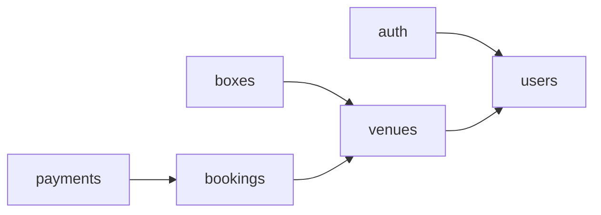
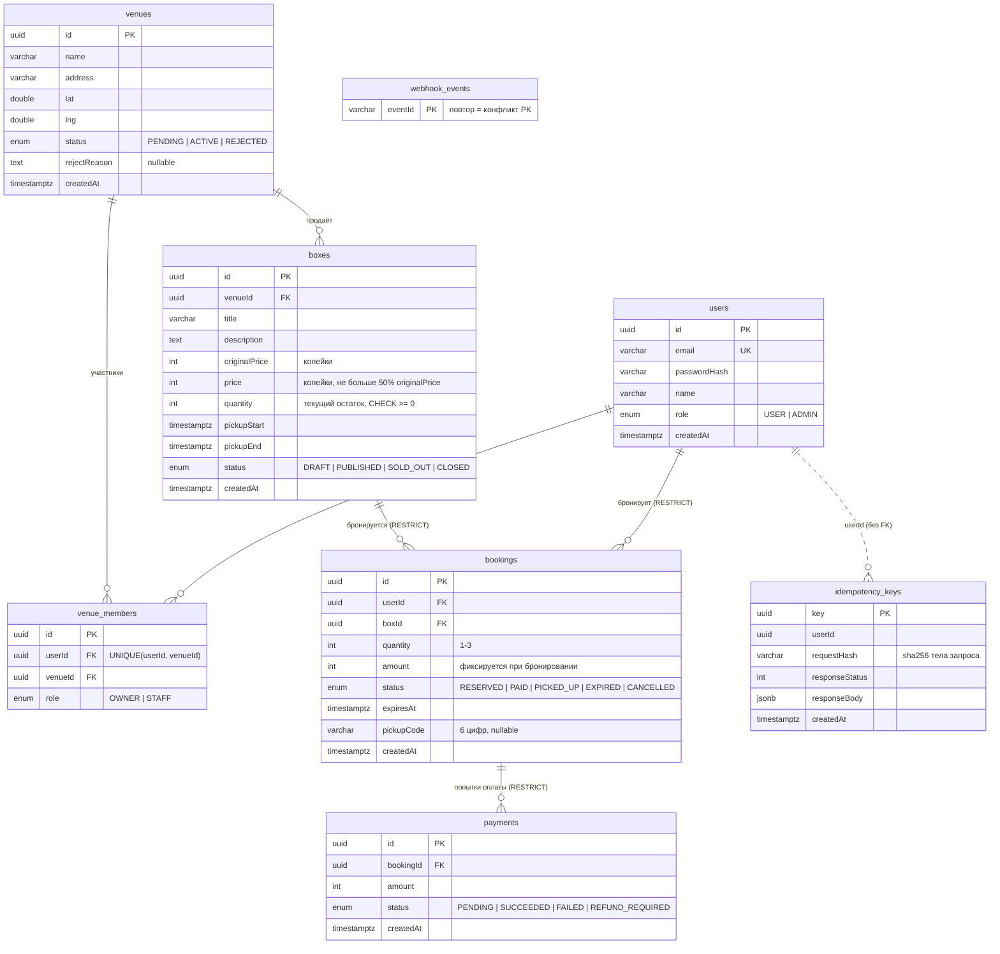
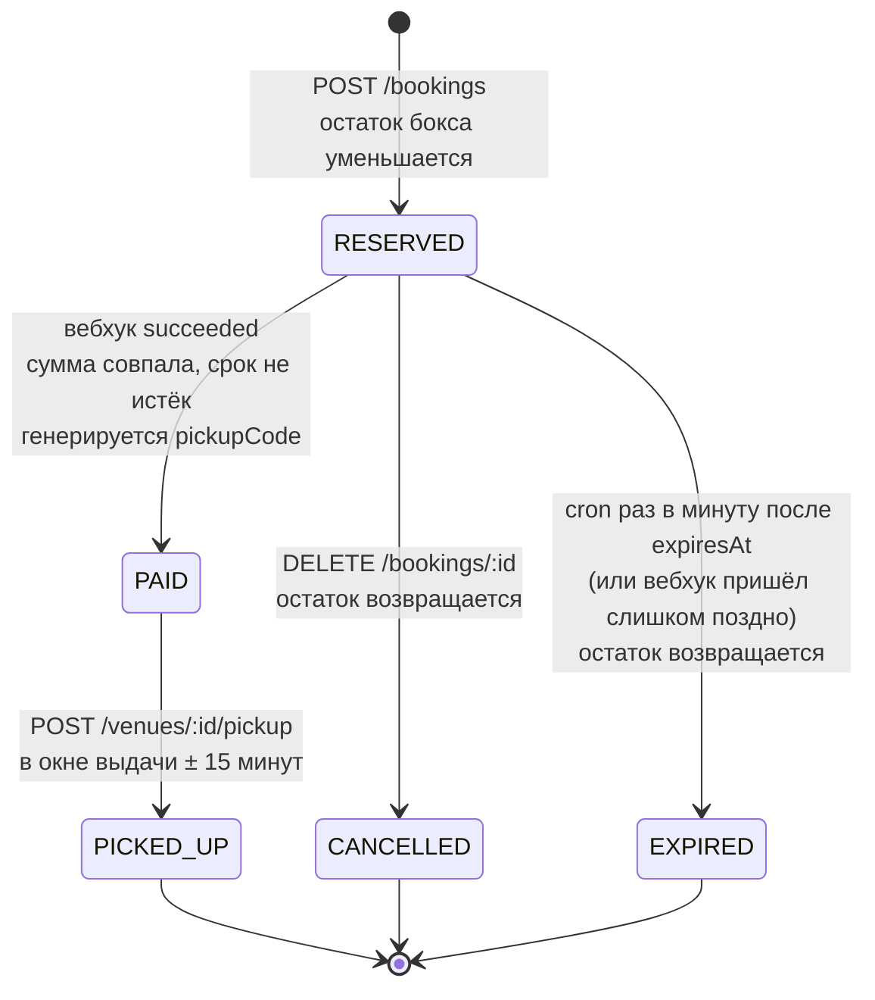

# Архитектура «ДоЗакрытия»

Монолит на NestJS: модули `auth`, `users`, `venues`, `boxes`, `bookings`, `payments`, `health`
поверх одной базы PostgreSQL. Каждый модуль — стандартные `module / controller / service / entity / dto`.

Зависимости модулей направлены в одну сторону, без циклов:

## ER-диаграмма

Деньги — `integer` в копейках, время — `timestamptz` (UTC). Внешние ключи броней и платежей — `ON DELETE RESTRICT`:
финансовую историю удалить нельзя.

## Статусы брони

Все переходы проходят через одну функцию `BookingsService.changeStatus`, которая сверяется с картой
`BOOKING_STATUS_TRANSITIONS` (`src/bookings/booking-status.ts`). Любой другой переход → `409 INVALID_STATUS_TRANSITION`.

Связанные статусы:

- **Бокс:** `DRAFT → PUBLISHED` (публикация владельцем); `PUBLISHED → SOLD_OUT`, когда остаток стал 0;
  `SOLD_OUT → PUBLISHED`, когда остаток вернулся (отмена или истечение брони). `CLOSED` зарезервирован, в MVP не используется.
- **Платёж:** создаётся `PENDING`; вебхук переводит его в `SUCCEEDED` (бронь стала PAID), `FAILED`
  (провайдер сообщил об ошибке или сумма не совпала) или `REFUND_REQUIRED` (деньги пришли, а бронь
  уже не оплатить — нужен возврат).

## Маршруты и роли

«Авторизованный» — есть валидная cookie `access_token`. OWNER / STAFF — роль в конкретном заведении
(`venue_members`), ADMIN — глобальная роль пользователя.

| Метод | Путь | Кто может | Что делает |
|---|---|---|---|
| POST | `/auth/register` | все | Регистрация (роль USER) |
| POST | `/auth/login` | все | Вход, ставит httpOnly cookie `access_token` (JWT на 24 часа) |
| POST | `/auth/logout` | все | Удаляет cookie |
| GET | `/auth/me` | авторизованный | Пользователь и его членства в заведениях с ролями |
| POST | `/venues` | авторизованный | Создать заведение (PENDING), создатель — OWNER |
| GET | `/venues/:id` | авторизованный | Заведение с боксами и участниками |
| POST | `/venues/:id/staff` | OWNER заведения | Добавить сотрудника (STAFF) по email |
| PATCH | `/admin/venues/:id/approve` | ADMIN | Одобрить → ACTIVE |
| PATCH | `/admin/venues/:id/reject` | ADMIN | Отклонить с причиной → REJECTED |
| GET | `/boxes` | все | Поиск: опубликованные боксы рядом, с расстоянием и пагинацией |
| POST | `/boxes` | OWNER заведения в статусе ACTIVE | Создать бокс (DRAFT) |
| POST | `/boxes/:id/publish` | OWNER заведения бокса | DRAFT → PUBLISHED |
| POST | `/bookings` | авторизованный, кроме OWNER/STAFF заведения бокса | Бронь (нужен заголовок `Idempotency-Key`) |
| GET | `/bookings/my` | авторизованный | Свои брони |
| DELETE | `/bookings/:id` | автор брони | Отмена: RESERVED → CANCELLED |
| POST | `/bookings/:id/pay` | автор брони | Создать платёж PENDING → `{ paymentId }` |
| POST | `/payments/webhook` | платёжный провайдер (подпись `X-Signature`) | Результат оплаты |
| POST | `/payments/dev/simulate/:paymentId` | все, только при `NODE_ENV != production` | Отправить себе подписанный вебхук succeeded |
| POST | `/venues/:id/pickup` | OWNER или STAFF заведения | Выдача по коду: PAID → PICKED_UP |
| GET | `/health` | все | Проверка API и подключения к БД |

## Где что проверяется

| Проверка | Где |
|---|---|
| Валидность JWT в cookie | `JwtAuthGuard` → `JwtStrategy` (`common/guards`, `auth/strategies`) |
| Глобальная роль ADMIN | `RolesGuard` + `@Roles()` |
| Роль в заведении (OWNER / STAFF) | `VenuesService.assertOwner / assertMember / getMemberRole` |
| Поля запросов | DTO + глобальный `ValidationPipe` |
| Правила бокса (цена, окно выдачи) | `validateBoxRules()` (`boxes/box-rules.ts`) |
| Переходы статусов брони | `assertBookingTransition()` (`bookings/booking-status.ts`) |
| Подпись вебхука | `WebhookSignatureGuard` (`payments/webhook-signature.guard.ts`) |
| Переменные окружения | `validateEnv()` при старте (`common/env.validation.ts`) |
